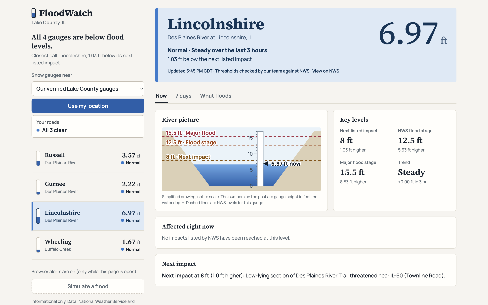

# FloodWatch

Live river levels for the Des Plaines River in Lake County, Illinois, turned into plain-language flood status.

Made by Pratham Rajpal and Sritejas Bommisetty for the 2026 Congressional App Challenge (Illinois 10th District).

Live site: https://prathamrajpal.github.io/floodwatch/

## What it does

The National Weather Service and USGS publish river gauge readings in feet, but that number doesn't tell most people if their street is about to flood. FloodWatch reads the live gauge height and shows:

- A status for each gauge: Normal, Watch, Warning or Major
- Every impact NWS lists at or below the current water level, and the next impact with how many feet away it is
- Whether the river is rising, and a rough time to the next impact (an estimate, not a forecast)
- Your roads: pick the roads you drive and see whether NWS lists them as threatened
- What changed since your last visit, plus optional browser alerts (only while the page is open)
- The last good readings, clearly labeled, if USGS can't be reached
- A river picture and a 7-day chart for each gauge
- A town picker and "Use my location" to find nearby NWS gauges

### Try it without a flood

Press **Simulate a flood** in the sidebar (press it again to go back to live readings). Simulated screens say "Simulated data (demo mode)."

## Where the data comes from

- Live gauge heights, about every 15 minutes: USGS
- Flood levels and impact statements: National Weather Service (NWS)

Our four gauges:

| Gauge | USGS ID | NWS ID |
|---|---|---|
| Des Plaines River near Russell | 05527800 | RUSI2 |
| Des Plaines River near Gurnee | 05528000 | GUNI2 |
| Des Plaines River at Lincolnshire | 05528100 | LDRI2 |
| Buffalo Creek near Wheeling | 05528500 | WHEI2 |

We checked the flood levels for these four gauges against the NWS pages. Other gauges use NWS data we haven't checked ourselves, and the page says so.

## Limits

- It is informational only, not an official warning. In an emergency call 911 and follow official alerts.
- It is not a road-closure report. NWS says "threatened," and so do we.
- The time to next impact is a rough guess.
- Browser alerts only work while the page is open.
- The river picture is simplified. The gauge height and NWS levels are real, but the shape of the channel is made up.
- "Use my location" and the town picker send a rough area to the NWS API to find nearby gauges. We don't store it.

## How it's built

Plain HTML, CSS and JavaScript, hosted on GitHub Pages. Chart.js draws the 7-day chart. The flood levels are in `js/thresholds.js`, and the USGS data is handled in `js/dashboard.js`.

## What a 2.0 would add

- A map of which roads are affected
- Push notifications, so alerts work when the page is closed
- ZIP code and city search
- The NWS active-alerts banner
- Moving to the newer USGS API

## Credits

Data: National Weather Service and USGS. Charts: Chart.js. Fonts: Manrope and Source Serif 4 (Google Fonts).
